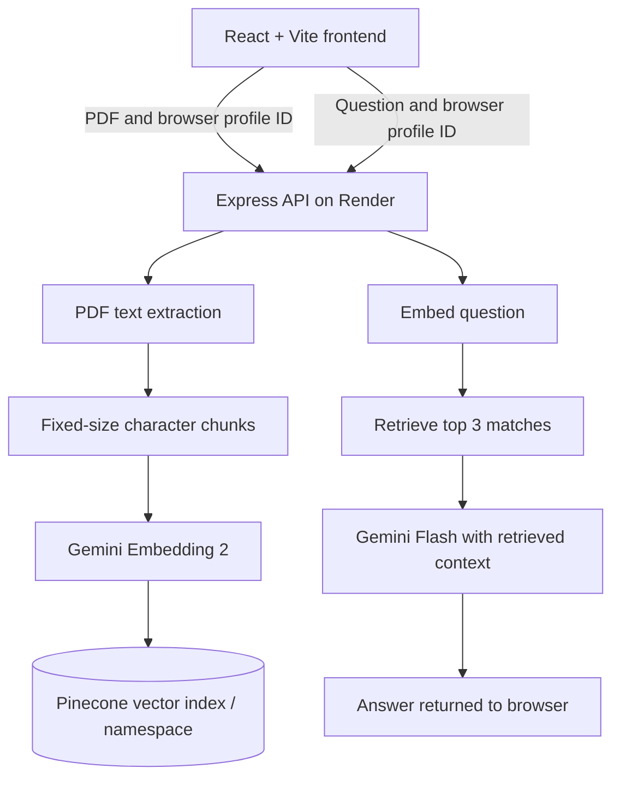

# Document Analyst

**Ask questions about a PDF using retrieval-augmented generation (RAG).** Document Analyst extracts text from a PDF, splits it into chunks, embeds those chunks, retrieves semantically similar passages, and passes the retrieved context to a language model to draft an answer.

> **Status:** Portfolio/demo application. The project demonstrates a working RAG pipeline, but it is not yet hardened for confidential documents or unrestricted public traffic.

## Overview

- Upload a text-based PDF (maximum **15 MB**).
- Extract text on the Node.js backend and split it into approximately **1,000-character chunks**.
- Generate **768-dimensional embeddings** using Gemini Embedding 2.
- Store and query vectors in a Pinecone index.
- Retrieve the top **3** matching passages for each question and send them to Gemini Flash as context.
- Deploy the React/Vite frontend to Vercel and the Express API to Render.

The model is instructed to say when the retrieved context does not contain enough information. Retrieval and generation are probabilistic, however, so answers can still be wrong or incomplete. Check important details against the source document.

## Architecture



### Request flow

1. **Upload:** the browser sends the PDF and a UUID stored in `localStorage` to `POST /upload`.
2. **Extract and chunk:** the API extracts text and slices it into approximately 1,000-character chunks. Chunks do not currently overlap, and page numbers are not retained.
3. **Embed and index:** the API creates an embedding for each chunk and upserts the vectors and text metadata into the Pinecone namespace associated with the browser UUID.
4. **Ask:** the browser sends the current question and the same UUID to `POST /chat`.
5. **Retrieve:** the API embeds the question and searches that namespace for the three nearest vectors.
6. **Generate:** the retrieved text and current question are sent to Gemini Flash, and the answer is returned to the browser.

## Technology stack

| Layer | Technology | Responsibility |
| --- | --- | --- |
| Frontend | React, Vite, CSS | PDF selection, upload status, chat interface and responsive UI |
| API | Node.js, Express | Upload endpoint, PDF extraction and RAG orchestration |
| Embeddings and answer generation | Google Gemini API | Vector embeddings and context-based answer generation |
| Vector database | Pinecone | Persistent vector storage and similarity search |
| Hosting | Vercel + Render | Static frontend and HTTP API service |

Model references: [Gemini models](https://ai.google.dev/gemini-api/docs/models), [Gemini Embedding 2](https://ai.google.dev/gemini-api/docs/models/gemini-embedding-2).

## Repository structure

```text
Document_Analyser/
├── README.md
├── LICENSE
├── .gitignore
├── backend/
│   ├── .env.example
│   ├── package.json
│   └── server.js
└── frontend/
    ├── .env.example
    ├── index.html
    ├── package.json
    ├── package-lock.json
    ├── vite.config.js
    ├── public/
    └── src/
        ├── App.jsx
        ├── App.css
        ├── index.css
        └── main.jsx
```

## Run locally

### Prerequisites

- Node.js **22 or newer** and npm.
- A Gemini API key.
- A Pinecone API key and a compatible Pinecone index.

### 1. Create the external resources

1. Create a Gemini API key in [Google AI Studio](https://aistudio.google.com/apikey).
2. Create a Pinecone API key in the [Pinecone Console](https://app.pinecone.io/).
3. Create a **dense Pinecone index** with **768 dimensions** and the **cosine** similarity metric. The default index name is `rag-index`.

The backend defaults to `gemini-embedding-2` for embeddings and `gemini-3.8-flash` for answer generation. Both model names can be overridden with environment variables. Model availability, quotas and pricing depend on your Google AI project and account.

### 2. Configure and start the backend

From the repository root:

```bash
cd backend
```

Copy `.env.example` to `.env`:

```bash
# macOS / Linux
cp .env.example .env

# Windows PowerShell (use this instead of the command above)
Copy-Item .env.example .env
```

Fill in the real credentials in `backend/.env`. Then install dependencies and start the API:

```bash
npm install
npm run dev
```

The API listens on `http://localhost:3000` by default. Check `http://localhost:3000/health` for a basic health response.

### 3. Configure and start the frontend

Open a second terminal from the repository root:

```bash
cd frontend
```

Copy `frontend/.env.example` to `frontend/.env` using the equivalent copy command for your operating system. The local value should be:

```dotenv
VITE_API_BASE_URL=http://localhost:3000
```

Then run:

```bash
npm install
npm run dev
```

Open the local URL printed by Vite, usually `http://localhost:5173`.

## Environment variables

### Backend — `backend/.env`

| Variable | Required | Purpose |
| --- | --- | --- |
| `GEMINI_API_KEY` | Yes | Server-side Gemini API key |
| `PINECONE_API_KEY` | Yes | Server-side Pinecone API key |
| `PINECONE_INDEX_NAME` | No | Pinecone index name; defaults to `rag-index` |
| `GEMINI_EMBEDDING_MODEL` | No | Embedding model; defaults to `gemini-embedding-2` |
| `GEMINI_CHAT_MODEL` | No | Answer model; defaults to `gemini-3.8-flash` |
| `FRONTEND_URL` | No | Allowed frontend origin or comma-separated origins; defaults to `http://localhost:5173` |
| `PORT` | No | HTTP port; defaults to `3000` locally. Render sets this in production. |

Example for multiple frontend origins:

```dotenv
FRONTEND_URL=https://your-app.vercel.app,https://your-custom-domain.com
```

Use origins only: include the scheme and hostname, but no route such as `/upload`.

### Frontend — `frontend/.env`

| Variable | Purpose |
| --- | --- |
| `VITE_API_BASE_URL` | Backend origin, such as `http://localhost:3000` locally or your Render service URL in production |

**Never commit real `.env` files or API keys.** Variables beginning with `VITE_` are bundled into browser-accessible JavaScript and must not contain secrets.

## Deployment

The repository contains two independently deployed services. Set a different root directory for each service.

### Backend — Render

1. Push the repository to GitHub.
2. In Render, select **New → Web Service** and connect the repository.
3. Set **Root Directory** to `backend`.
4. Set **Build Command** to `npm install`.
5. Set **Start Command** to `npm start`.
6. Add the backend environment variables listed above. Set `FRONTEND_URL` to the exact Vercel origin, for example `https://your-app.vercel.app`.
7. Optionally set Render's HTTP health-check path to `/health`.
8. Deploy and open `https://YOUR-RENDER-SERVICE.onrender.com/health`. The current endpoint returns `{"ok":true}` when the Express process is responsive; it does **not** verify that Gemini and Pinecone are reachable.

Render free web services can spin down after a period of inactivity, so the first request after idle time may be slow. See [Render free service limitations](https://render.com/docs/free).

### Frontend — Vercel

1. Import the same GitHub repository as a Vercel project.
2. Set **Root Directory** to `frontend` and choose the Vite framework preset.
3. Set **Build Command** to `npm run build` and **Output Directory** to `dist`.
4. Add this environment variable in Vercel project settings:

   ```dotenv
   VITE_API_BASE_URL=https://YOUR-RENDER-SERVICE.onrender.com
   ```

5. Deploy or redeploy after changing the variable. Vite embeds `VITE_` variables at build time, so an existing build will not pick up a newly added value until rebuilt.
6. Copy the final Vercel origin to Render's `FRONTEND_URL` and redeploy the backend if needed.

The frontend contains a production fallback to `https://rag-document-analyst-api.onrender.com`, but setting `VITE_API_BASE_URL` explicitly is recommended.

## API endpoints

| Method | Endpoint | Request | Purpose |
| --- | --- | --- | --- |
| `GET` | `/` | — | Basic API status |
| `GET` | `/health` | — | Basic process health check |
| `POST` | `/upload` | `multipart/form-data`: `document` (PDF) and `sessionId` (UUID) | Extract, embed and index PDF text |
| `POST` | `/chat` | JSON: `{ "question": "...", "sessionId": "..." }` | Retrieve matching chunks and generate an answer |

## Limitations and known trade-offs

These are current implementation limitations, not features that are already solved.

- **No authentication or authorization.** The browser creates a UUID and stores it in `localStorage`; the backend uses it as a Pinecone namespace. This separates ordinary browser profiles but is not a security boundary. A UUID can be copied or spoofed.
- **Uploads accumulate in a namespace.** Uploading another PDF from the same browser profile does not delete previous vectors. Questions may retrieve passages from earlier uploads because retrieval searches the whole namespace. There is no document deletion or reset endpoint yet.
- **The chat is not conversational at the model layer.** The browser displays chat history, but each `/chat` request sends only the current question and session ID. Earlier turns are not passed back to Gemini.
- **No source citations in answers.** Chunk metadata stores extracted text and the filename, but not page numbers or stable chunk references. The UI cannot currently cite a page or passage precisely.
- **Basic chunking.** Text is split every 1,000 characters with no overlap or sentence-boundary awareness. Relevant information near a chunk boundary may be split, and fixed character length is not the same as a token limit.
- **Text-based PDFs only.** Scanned/image-only PDFs are not OCR-processed. Extraction quality can also vary with multi-column layouts, tables, headers and unusual PDF encodings.
- **Upload work is synchronous.** The API holds the upload in memory and embeds chunks sequentially in one request. Large PDFs may take a while, use substantial memory, or hit provider quotas/timeouts. There is no background job queue or progress stream.
- **Limited reliability controls.** Retry/backoff, provider-specific rate-limit handling, request timeouts, upload concurrency controls and user quotas are not fully implemented.
- **No automated test suite.** The frontend has a lint script, but backend unit/integration tests and a measured RAG evaluation dataset have not been added.
- **Basic health endpoint.** `/health` confirms that the process responds; it does not run dependency checks against Gemini or Pinecone.
- **Third-party processing.** Extracted text is sent to Gemini for embeddings and answer generation, and stored as metadata in Pinecone. Do not upload confidential, regulated or sensitive documents to this demo.
- **No answer guarantee.** Semantic search may retrieve the wrong passages, and the model may still make unsupported claims despite the prompt. Verify important information against the original PDF.

## Recommended next improvements

A sensible order for taking the project closer to production:

1. **Document lifecycle:** assign each upload a `documentId`, filter retrieval to that document, and add delete/replace functionality so old chunks cannot contaminate a new upload.
2. **Grounded citations:** preserve page numbers and chunk IDs during extraction; return source snippets and page references with each answer.
3. **Better retrieval:** use sentence-aware, overlapping chunks; compare retrieval quality for different chunk sizes and `topK` values; consider metadata filtering and reranking only after measuring the baseline.
4. **Security and abuse prevention:** add authentication, server-side ownership checks, request rate limits, file validation, document-size/page-count limits, and cleanup policies.
5. **Reliability and scale:** add bounded concurrency, retries with exponential backoff for transient provider failures, explicit timeouts, and background jobs for large PDFs.
6. **Evaluation:** build a small set of PDFs with known questions and expected source passages; measure retrieval recall, answer correctness, latency and cost before claiming quality improvements.
7. **Operations:** add structured request logs, request IDs, dependency-aware readiness checks and safe metrics without logging document contents or API secrets.

## Resume-ready project summary

**Document Analyst — Full-Stack RAG Application**

- Built a full-stack PDF question-answering application using React, Node.js/Express, Google Gemini and Pinecone.
- Implemented a RAG pipeline that extracts PDF text, creates 768-dimensional embeddings, retrieves the top three semantically similar passages, and supplies them as context for answer generation.
- Deployed the Vite frontend on Vercel and Express API on Render, with environment-based configuration and browser-profile-scoped Pinecone namespaces.

These bullets describe the current repository. Add performance, accuracy, user-count or cost metrics only after measuring them.

## License

See [LICENSE](LICENSE).
