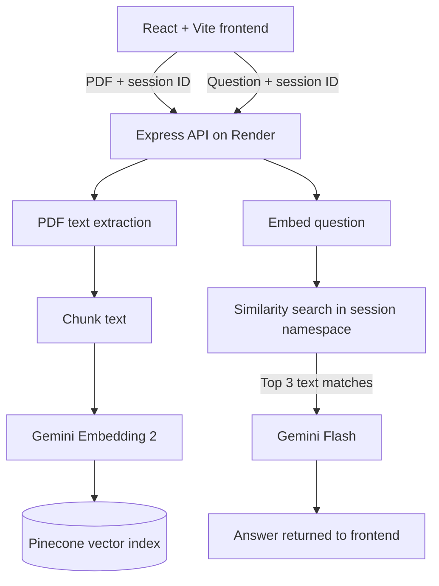

# Document Analyst

A full-stack PDF question-answering app built around **Retrieval-Augmented Generation (RAG)**. Upload a text-based PDF, index its content, and ask questions in natural language. The API retrieves semantically relevant passages from the document and gives those passages to a language model as context for its answer.

> **Deployment:** Vercel frontend + Render API. Configure the project-specific URLs using the deployment steps below.

## What it does

- **PDF ingestion:** accepts PDF files up to 15 MB and extracts their text on the backend.
- **Chunking and embeddings:** splits extracted text into roughly 1,000-character chunks and converts each chunk into a 768-dimensional embedding with Gemini Embedding 2.
- **Semantic retrieval:** stores vectors in Pinecone and retrieves the three nearest matches for each question.
- **Context-aware answers:** sends the retrieved passages and the question to Gemini Flash, with instructions to say when the document does not contain enough information.
- **Session-scoped namespaces:** uses a random browser session ID to separate each browser profile's vector namespace from other sessions.
- **Split deployment:** React/Vite on Vercel and the Express API on Render.

Answers can still be incomplete or incorrect. Check important details against the original document. Scanned/image-only PDFs are not OCR-processed.

## Architecture



### Request flow

1. **Upload:** the browser posts the PDF and its session ID to `POST /upload`.
2. **Index:** the API extracts text, chunks it, creates 768-dimensional embeddings, and upserts each chunk with its text metadata into the matching Pinecone namespace.
3. **Ask:** the browser posts a question and the same session ID to `POST /chat`.
4. **Retrieve:** the API embeds the question and asks Pinecone for the three nearest vectors in that namespace.
5. **Generate:** the retrieved text is passed to Gemini with the question. The model returns an answer based on that context.

## Tech stack

| Layer | Technology | Responsibility |
| --- | --- | --- |
| Frontend | React, Vite, CSS | File selection, upload state, chat UI, responsive layout |
| API | Node.js, Express | PDF upload endpoint, extraction, retrieval orchestration |
| Embeddings / generation | [Google Gemini API](https://ai.google.dev/gemini-api/docs/models) | Text embeddings and answer generation |
| Vector database | Pinecone | Store and retrieve chunk embeddings |
| Hosting | Vercel + Render | Frontend build and persistent HTTP API service |

## Repository structure

```text
Document_Analyser/
├── README.md
├── LICENSE
├── .gitignore
├── backend/
│   ├── .env.example
│   ├── package.json
│   └── server.js
└── frontend/
    ├── .env.example
    ├── index.html
    ├── package.json
    ├── package-lock.json
    ├── vite.config.js
    ├── public/
    └── src/
        ├── App.jsx
        ├── App.css
        ├── index.css
        └── main.jsx
```

## Run locally

Requirements: Node.js 22 or later, npm, a Gemini API key, and a Pinecone index.

### 1. Configure Pinecone and Gemini

1. Create a Gemini API key in [Google AI Studio](https://aistudio.google.com/apikey).
2. Create a Pinecone API key in the [Pinecone Console](https://app.pinecone.io/).
3. Create a **dense** Pinecone index with **768 dimensions** and the **cosine** similarity metric. The default index name is `rag-index`.

The backend uses `gemini-embedding-2` by default and requests 768-dimensional output embeddings. The default chat model is `gemini-3.8-flash`. Both are configurable through environment variables.

### 2. Start the backend

From the repository root:

```bash
cd backend
cp .env.example .env
```

On Windows PowerShell, use `Copy-Item .env.example .env` instead of `cp`.

Edit `backend/.env` and supply your real API keys. Then run:

```bash
npm install
npm run dev
```

The API listens on `http://localhost:3000` by default. Its health endpoint is `http://localhost:3000/health`.

### 3. Start the frontend

Open a second terminal from the repository root:

```bash
cd frontend
cp .env.example .env
npm install
npm run dev
```

Open the local address printed by Vite (usually `http://localhost:5173`). The local frontend environment points to `http://localhost:3000`.

## Deploy

The same GitHub repository can power two separate services. Set a different **Root Directory** for each deployment.

### Backend — Render

1. Push the project to GitHub.
2. In Render, choose **New → Web Service** and connect the repository.
3. Set **Root Directory** to `backend`.
4. Set **Build Command** to `npm install` and **Start Command** to `npm start`.
5. Add these environment variables in the Render dashboard:

   | Variable | Example / value |
   | --- | --- |
   | `GEMINI_API_KEY` | Your Gemini API key |
   | `PINECONE_API_KEY` | Your Pinecone API key |
   | `PINECONE_INDEX_NAME` | `rag-index` |
   | `GEMINI_EMBEDDING_MODEL` | `gemini-embedding-2` |
   | `GEMINI_CHAT_MODEL` | `gemini-3.8-flash` |
   | `FRONTEND_URL` | Your exact Vercel origin, e.g. `https://your-project.vercel.app` |

6. Deploy and visit `https://YOUR-RENDER-SERVICE.onrender.com/health`. A healthy service returns `{"ok":true}`.

### Frontend — Vercel

1. Import the same GitHub repository as a Vercel project.
2. Set **Root Directory** to `frontend` and use the Vite framework preset.
3. Use `npm run build` as the build command and `dist` as the output directory.
4. Add the environment variable below in Vercel project settings:

   ```text
   VITE_API_BASE_URL=https://YOUR-RENDER-SERVICE.onrender.com
   ```

5. Deploy or redeploy after adding/updating the variable. Vite variables are embedded during the build, so an already-built deployment will not pick up a changed value.
6. Copy your final Vercel origin into Render's `FRONTEND_URL` setting and redeploy the backend if you changed it.

The frontend keeps a production fallback to `https://rag-document-analyst-api.onrender.com`, but configuring `VITE_API_BASE_URL` explicitly is recommended.

## Environment variables

### `backend/.env`

| Variable | Required | Purpose |
| --- | --- | --- |
| `GEMINI_API_KEY` | Yes | Server-side Gemini API credential |
| `PINECONE_API_KEY` | Yes | Server-side Pinecone credential |
| `PINECONE_INDEX_NAME` | No | Index name; defaults to `rag-index` |
| `GEMINI_EMBEDDING_MODEL` | No | Defaults to `gemini-embedding-2` |
| `GEMINI_CHAT_MODEL` | No | Defaults to `gemini-3.8-flash` |
| `FRONTEND_URL` | No | Comma-separated allowed browser origins; defaults to local Vite origin |
| `PORT` | No | Server port; Render provides it in production, local default is `3000` |

### `frontend/.env`

| Variable | Purpose |
| --- | --- |
| `VITE_API_BASE_URL` | Backend origin, e.g. `http://localhost:3000` locally or your Render URL in production |

Never add real `.env` files or API keys to GitHub. Variables prefixed with `VITE_` are bundled into browser code and must not contain secrets.

## API endpoints

| Method | Endpoint | Request | Purpose |
| --- | --- | --- | --- |
| `GET` | `/` | — | Basic service status |
| `GET` | `/health` | — | Health check |
| `POST` | `/upload` | `multipart/form-data`: `document` (PDF), `sessionId` (UUID) | Extract, embed, and index the PDF |
| `POST` | `/chat` | JSON: `{ "question": "...", "sessionId": "..." }` | Retrieve matching chunks and generate an answer |

## Limitations and security notes

- **No authentication:** the random session ID gives basic namespace separation for the demo; it is not a full authorization system.
- **No deletion workflow:** vectors from uploaded PDFs remain in Pinecone until you remove them from the index/namespace.
- **No rate limiting or usage caps:** protect the API before accepting significant public traffic.
- **PDF support:** text-based PDFs up to 15 MB are accepted. Scanned/image-only PDFs need OCR, which is not implemented.
- **No answer guarantee:** retrieval can miss relevant passages, and a model can produce an incorrect or incomplete answer. Verify important information against the source document.
- **Cost and quotas:** Gemini, Pinecone, Render, and Vercel usage is subject to each provider's limits and pricing.

Do not use this demo to process confidential, regulated, or sensitive documents.

## Resume-ready project summary

**Document Analyst — Full-Stack RAG Application**

- Built a full-stack PDF question-answering application with React, Node.js/Express, Google Gemini, and Pinecone.
- Implemented a retrieval pipeline that extracts PDF text, chunks content, creates 768-dimensional embeddings, and retrieves the top three semantically similar passages for question answering.
- Deployed the frontend on Vercel and the API on Render, with environment-based configuration and per-browser Pinecone namespaces.

These bullets describe the functionality in this repository; add measured performance or usage metrics only after you have measured them.
